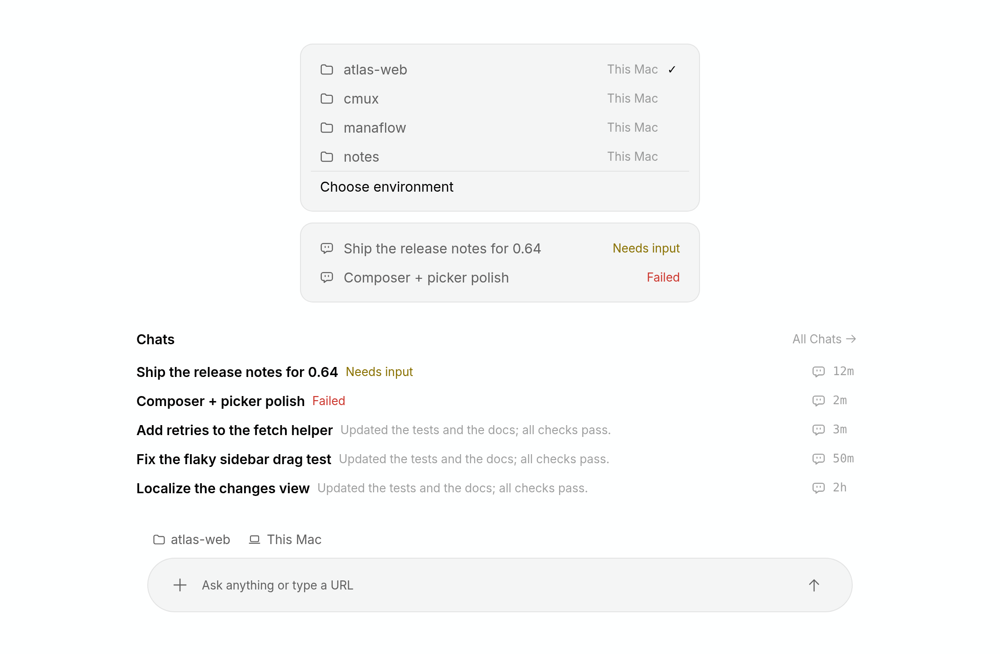

# Default New Tab

[](https://cmux.com/setups/manaflow-ai/cmux-newtab-default-look)



cmux's Default New Tab page, as a look you install, laid out like Claude's desktop new-session
screen: over the composer, centered, the environment card (the folder the chat starts in, this
Mac's other recent projects, Choose environment) and the suggestions card (the chats that need
you), then your five most recent chats as quiet rows.

It used to ship inside cmux as a New Tab template. It is now built only on the public
customization API, so you can read and change every part of it:

| File | What it does |
| --- | --- |
| `cmux-setup.json` | Sets `tabs.newTabApp` to this look's view, so it draws the New Tab page |
| `customize/` | A `cmux.newtab/1` view: the cards, the recent rows and the composer (`main.js`) |
| `shots/` | How the screenshots are drawn: `main.js` in cmux's own app runtime, through cmux's web New Tab page |
| `SHOTS.md` | Before (the template cmux shipped) and after (this look), side by side |

```sh
cmux setup install github.com/manaflow-ai/cmux-newtab-default-look
cmux setup remove manaflow-ai/newtab-default-look
```

Reading your chats and projects is granted at install. Starting a chat, opening one and choosing a
folder need Run actions and Change workspaces, which you turn on in Settings > Apps > My views.

While it is installed, its `customize/` view stands in for your own view, if you have one;
`cmux setup remove` puts yours back and cmux draws its own New Tab page again.

## What the public API does not do yet

The look follows cmux's own page as far as the API reaches today. What is still missing is
tracked in the cmux repository and lands there, not here:

- cmux's own composer as a view node, with a folder the view can set (the environment card's rows
  pick it) and its footer (mode, model, effort). Until then the field is a plain text field that
  starts a chat with `newTab.submit`, in a new tab, and a row only marks the folder.
- cmux's project chooser for Choose environment (search, a typed path, Browse, No project).
- The page's height for the view, so the composer sits at the page's foot; until then it follows
  the cards.
- Recent chats and the chats that need you, read and ordered by cmux itself, with each chat's last
  reply; the rows' hover card; an agent's own mark; the cards' raised surface and shadow.
