# Shots: before and after

**Before**: the Default template cmux shipped, at cmux `99039d5bf89c` (feat-cmux-next), from its web
gallery (webviews/), rendered on the build fleet with gallery fixtures (no real chats).

**After**: this look's `customize/main.js` run in cmux's own app runtime
(cmux-tui/crates/cmux-app-host, its reference host), answering `agent_chat.list`, `project.list` and
`agent_cli.list` from the same fixtures, and its scene drawn by cmux's web New Tab page
(NewTabAppPage, the page that draws a `cmux.newtab/1` app once `tabs.newTabApp` names it). Reproduce:
`bash shots/capture.sh OUT .` from a cmux checkout. The fixtures answer `agent_chat.list` with `limit`
and a `preview` field, the shape of the recent-chats read cmux is adding.

1100 x 720 points, 2x.

## No chats

| | Before (template) | After (this look) |
| --- | --- | --- |
| light | 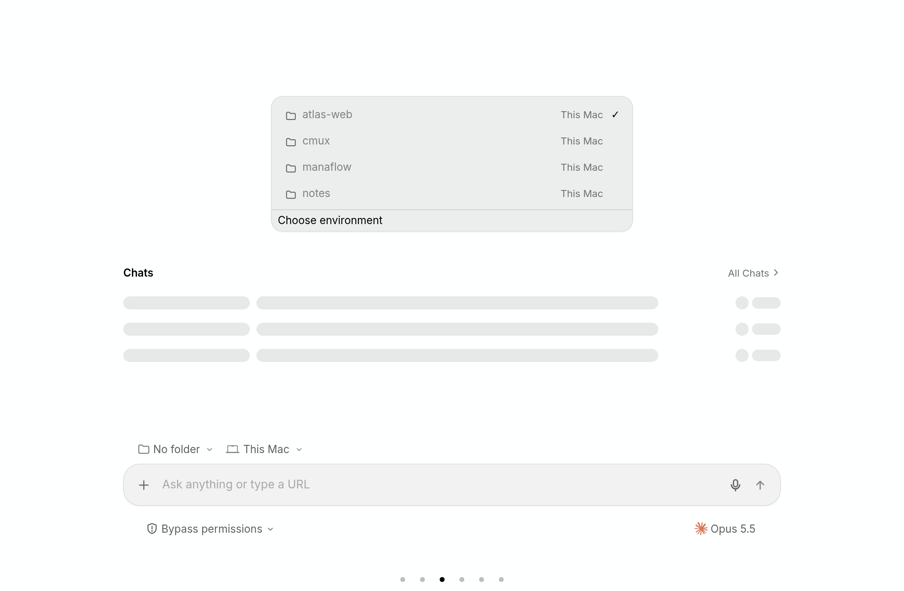 | 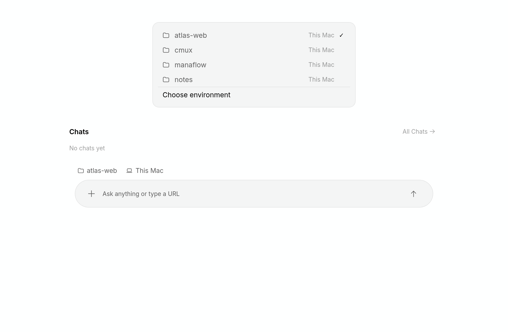 |
| dark | 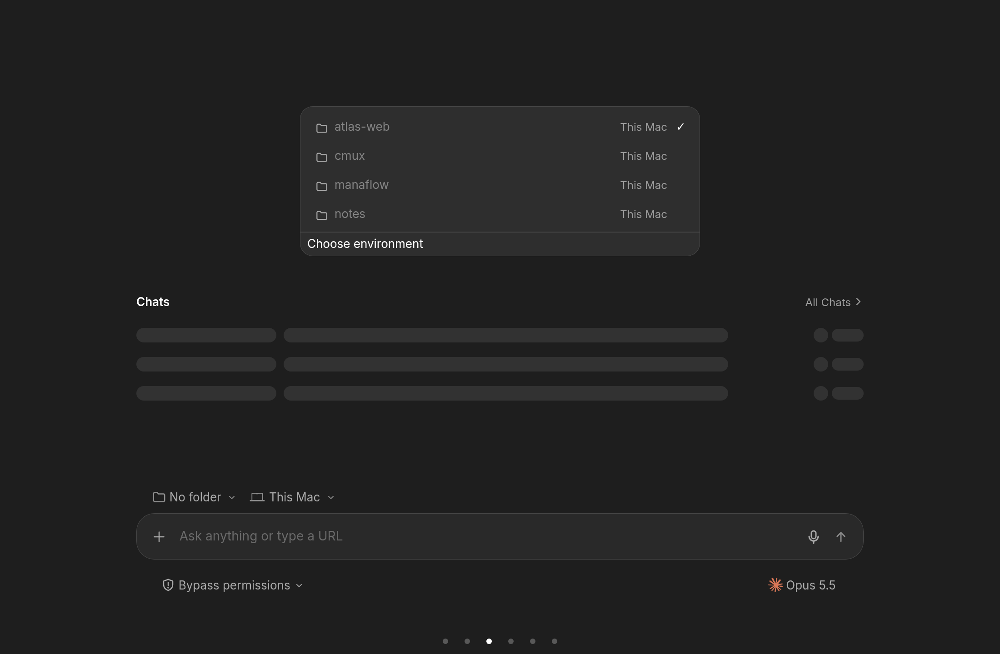 | 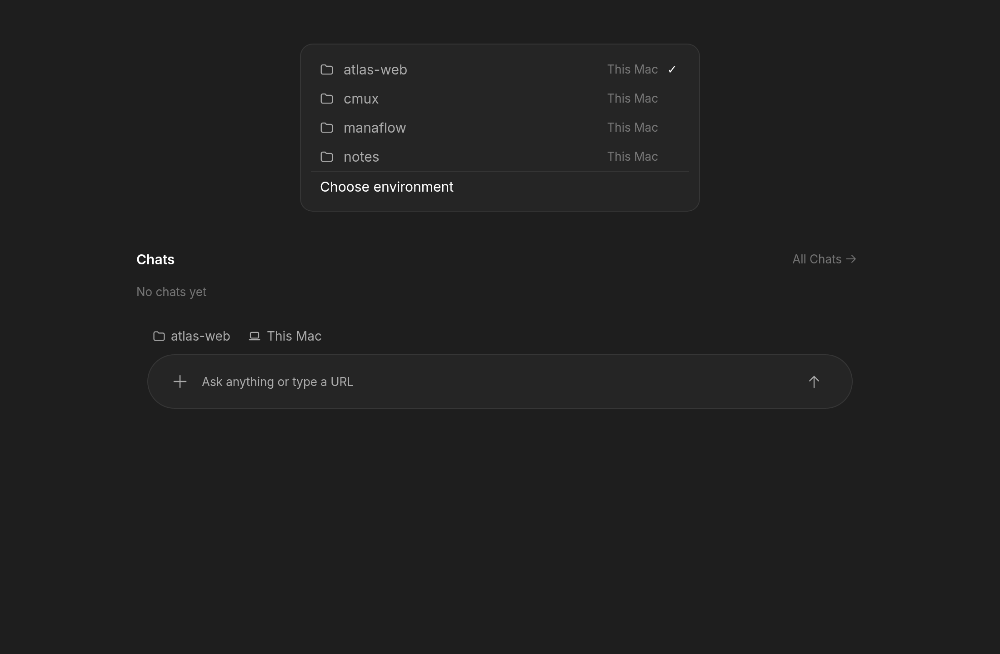 |

## Chats that need you, then quiet ones

| | Before (template) | After (this look) |
| --- | --- | --- |
| light | 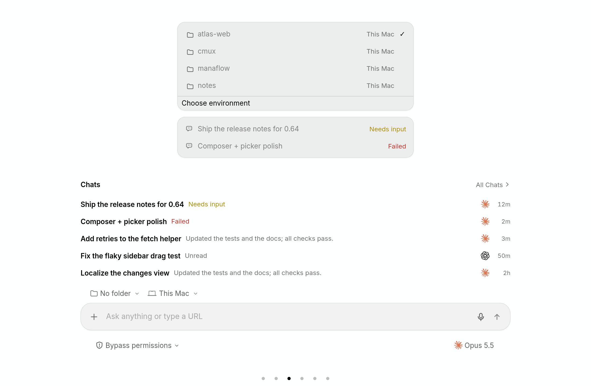 | 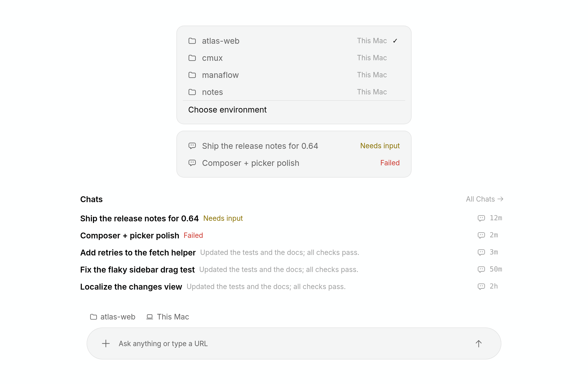 |
| dark | 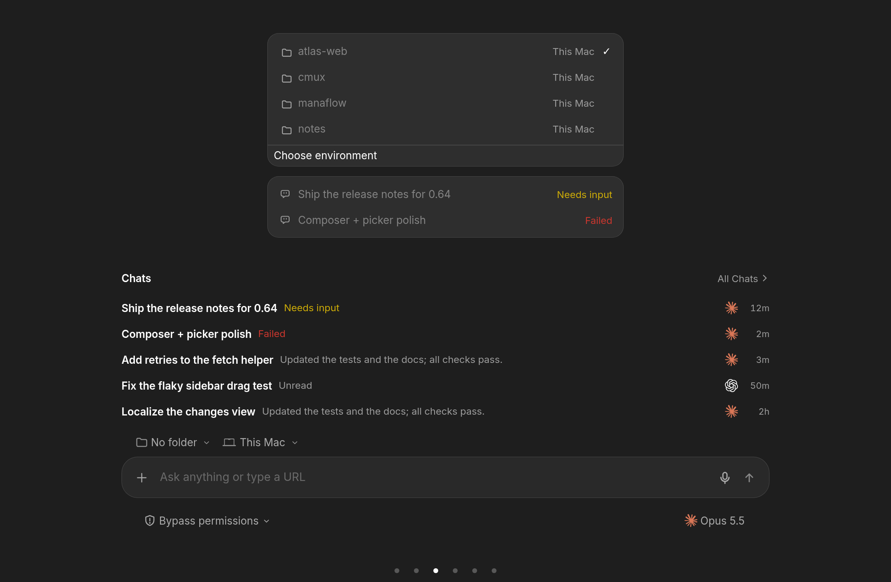 | 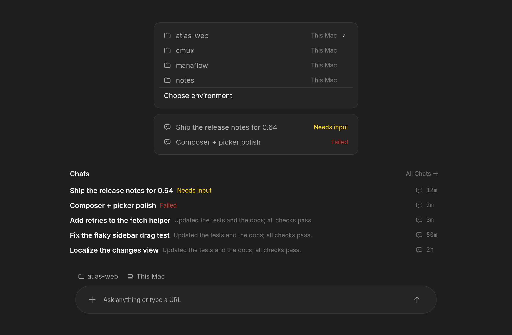 |

## 10,000 chats

| | Before (template) | After (this look) |
| --- | --- | --- |
| light | 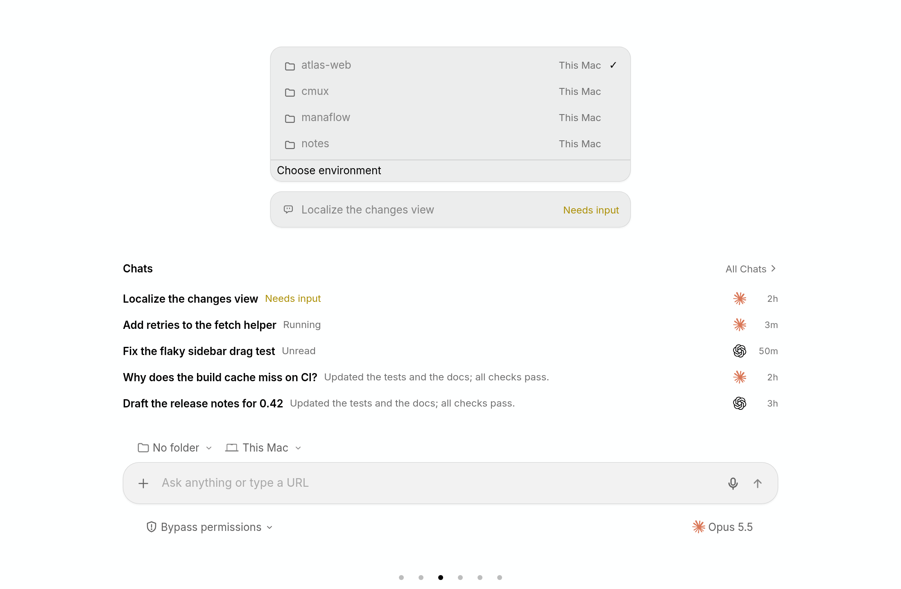 | 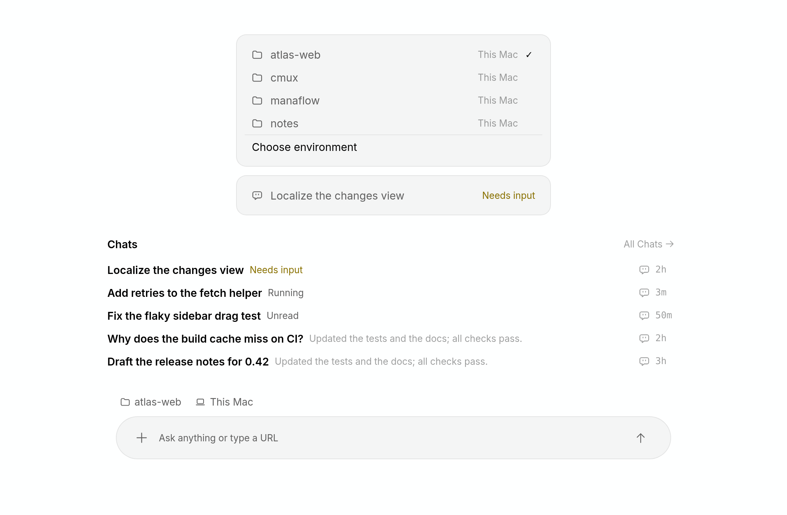 |
| dark | 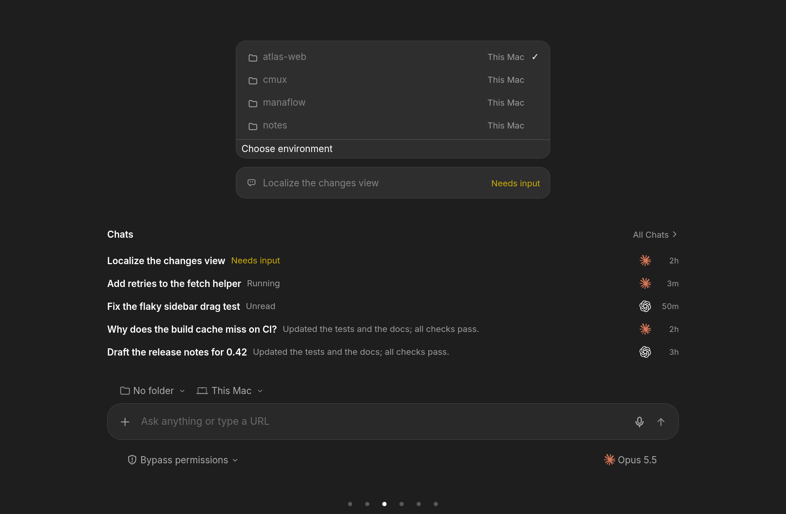 |  |

## After only: few

| light | dark |
| --- | --- |
|  | 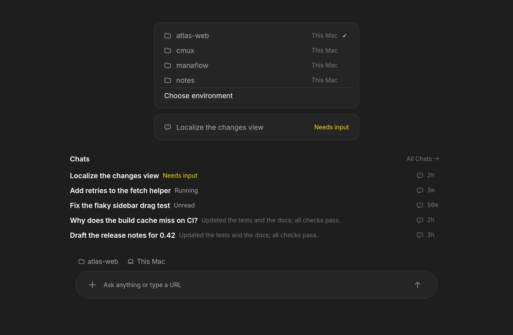 |

